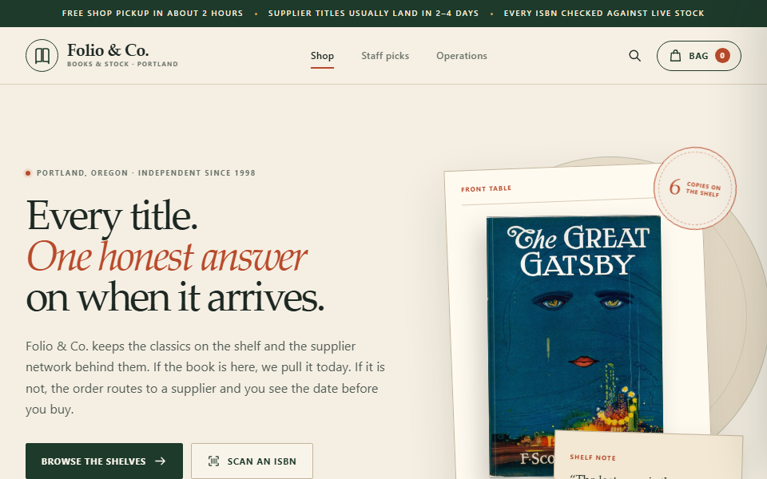

# Folio & Co.

**A bookstore where every title has one honest answer to "when will it arrive?"**

[Live demo](https://book-shop-022121007134254731280.vercel.app) | HTML, CSS and JavaScript, no build step



An independent bookshop storefront with a real inventory engine behind it. Shelf stock, supplier
stock and pre-orders feed one product record, so the shop can promise a pickup time or a supplier
date before the customer pays.

## What it does

- **Fourteen public-domain classics**, each with a local cover scan and a per-book credit.
- **Search and category filters**, a book detail page, a bag, and a simulated checkout.
- **Shelf or supplier, or both.** One order can split across stock the shop holds and stock a
  supplier ships, with each line showing where it will come from and when.
- **ISBN-13 scanner** with checksum validation, for adding a book by scanning the barcode.
- **CSV catalog importer** with duplicate detection and supplier checks.
- **An operations desk.** Inventory levels, reorder points, supplier records, and a filterable order
  queue that shows what still needs picking.

## Run it locally

```bash
node dev-server.mjs
```

Open <http://127.0.0.1:4197>. Nothing to install. Use `$env:PORT=4198; node dev-server.mjs` on
Windows, or `PORT=4198 node dev-server.mjs` on macOS and Linux, if the port is taken.

## Verify

```bash
node tests/run.mjs
node tests/smoke.mjs
```

`tests/run.mjs` checks the inventory rules, routing decisions, ISBN validation and importer
behaviour. `tests/smoke.mjs` serves the app and walks the storefront, checkout, scanner and import
routes over HTTP.

## How it is built

| Path | Purpose |
|---|---|
| `index.html` | Storefront, bag, scanner, inventory desk and order queue |
| `assets/app.mjs` | Views, state and event wiring |
| `assets/data.mjs` | The fourteen classics, stock levels, suppliers and orders |
| `assets/engine.mjs` | Inventory rules: allocation, routing, dates, checksums |
| `assets/styles.css` | The whole visual system |
| `assets/covers/` | Local public-domain cover scans |
| `COVERS.md` | Source and licence note for every cover |
| `tests/` | Verification and route smoke tests |

## What is simulated

Inventory, checkout, supplier feeds and persistence are simulated. The catalog, stock levels,
delivery dates and orders are seeded sample data, and no payment is taken.

## About this prototype

Built as a working prototype for a real brief, then published as part of a portfolio. The inventory
engine is the point: one record drives the badge, the bag note, the stock deduction and the order
queue. It is a demonstration, not a production shop.
